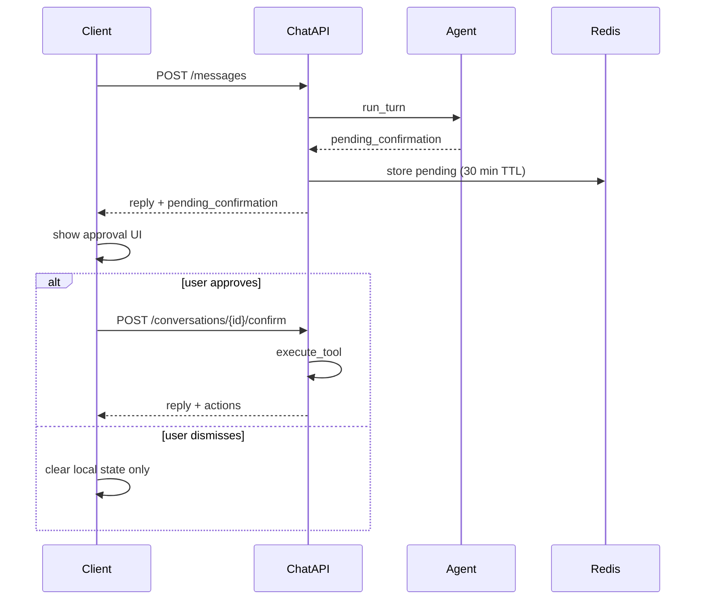

# Chat API Integration Guide

Reference for building a chatbot client against the Lake **Toston** finance assistant. This document covers the HTTP chat API at `/api/v1/chat` — the natural-language interface backed by an OpenRouter tool-calling agent.

For direct REST CRUD (without the agent), see [API_CAPABILITIES.md](./API_CAPABILITIES.md).

**Reference client:** [`chat/`](../chat/) (React SPA with API wrapper in `chat/src/api/chat.ts` and state management in `chat/src/hooks/useChat.ts`).

---

## Overview

| Property | Value |
|----------|-------|
| Base path | `{host}/api/v1/chat` |
| Protocol | JSON over HTTP; optional **SSE** streaming on `/messages/stream` |
| Streaming | **SSE** on `POST /messages/stream` — token deltas + tool steps; JSON `POST /messages` still available |
| Agent | OpenRouter LLM with in-process finance tools |
| Storage | Conversations and pending confirmations in Redis |
| Language | Assistant replies in **Spanish** by default |

Each user message triggers a full agent turn on the server. Use **`POST /messages/stream`** for incremental updates (tool progress and assistant text tokens). Use **`POST /messages`** for a single JSON payload after the turn completes (may take several seconds when multiple tools run).

**Feature flag:** When `CHAT_ENABLED=false` on the server, all chat endpoints return **503** with detail `"Chat is disabled"`.

---

## Authentication

All chat routes require an **active authenticated user**.

| Mechanism | Header / cookie | How to obtain |
|-----------|-------------------|---------------|
| Local JWT | `Authorization: Bearer <token>` | `POST /api/v1/login/access-token` with form fields `username` (email) and `password` |
| Clerk session | `__session` cookie | Clerk-authenticated browser session |

**Error responses:**

| Status | When |
|--------|------|
| **401** | Missing or invalid token |
| **400** | User exists but is inactive |
| **404** | Valid token but no matching user in database |

### Example: login and first message

```bash
# 1. Obtain token
TOKEN=$(curl -s -X POST "https://your-host/api/v1/login/access-token" \
  -H "Content-Type: application/x-www-form-urlencoded" \
  -d "username=user@example.com&password=your-password" \
  | jq -r .access_token)

# 2. Send first message (omit conversation_id to start a new thread)
curl -s -X POST "https://your-host/api/v1/chat/messages" \
  -H "Authorization: Bearer $TOKEN" \
  -H "Content-Type: application/json" \
  -d '{"message": "Lista mis cuentas"}'
```

---

## Endpoints

| Method | Path | Purpose |
|--------|------|---------|
| `POST` | `/api/v1/chat/messages` | Send a user message; run agent turn (JSON response) |
| `POST` | `/api/v1/chat/messages/stream` | Same as `/messages`, but **SSE** stream |
| `GET` | `/api/v1/chat/conversations` | List conversations for current user |
| `GET` | `/api/v1/chat/conversations/{id}` | Load conversation message history |
| `DELETE` | `/api/v1/chat/conversations/{id}` | Delete a conversation |
| `POST` | `/api/v1/chat/conversations/{id}/confirm` | Execute a pending write/delete after user approval |

---

### POST `/messages`

Send a user message and receive the agent's reply.

**Request body** (`ChatMessageRequest`):

```json
{
  "message": "¿Cuánto gasté este mes?",
  "conversation_id": "optional-uuid-from-prior-response"
}
```

| Field | Type | Required | Constraints |
|-------|------|----------|-------------|
| `message` | string | yes | 1–8000 characters |
| `conversation_id` | string | no | Omit on first message; server generates a UUID |

**Response** (`ChatMessageResponse`, 200):

```json
{
  "conversation_id": "550e8400-e29b-41d4-a716-446655440000",
  "reply": "Este mes gastaste 1.234,56 en total.",
  "actions": [
    {
      "type": "summary_fetched",
      "detail": {
        "period_net": -1234.56,
        "total_expenses": 1500.0,
        "total_incomes": 265.44
      }
    }
  ],
  "tool_steps": [
    {
      "tool_name": "get_period_summary",
      "status": "completed",
      "label": "Fetched period summary"
    }
  ],
  "pending_confirmation": null
}
```

### POST `/messages/stream`

Streaming variant of `/messages`. Same request body (`ChatMessageRequest`). Response is **`text/event-stream`** (Server-Sent Events).

**Headers:** `Authorization: Bearer <token>`, `Content-Type: application/json`

**SSE events** (each block is `event: <name>\ndata: <json>\n\n`):

| Event | When | `data` shape |
|-------|------|----------------|
| `meta` | First event | `{"conversation_id": "uuid"}` |
| `tool_step` | After each tool finishes (or pending confirmation) | `ToolStep` object |
| `token` | Assistant text delta (final LLM reply only) | `{"delta": "..."}` |
| `done` | Turn complete; conversation saved | Full `ChatMessageResponse` |
| `error` | Unhandled failure | `{"detail": "..."}` |

Tool rounds and confirmation prompts do not emit `token` events; the full `reply` is in the final `done` event.

**Example:**

```bash
curl -N -X POST "https://your-host/api/v1/chat/messages/stream" \
  -H "Authorization: Bearer $TOKEN" \
  -H "Content-Type: application/json" \
  -d '{"message": "Lista mis cuentas"}'
```

**Client notes:** Use `fetch` with `response.body.getReader()` (or `EventSource` is not suitable for POST). Parse `\n\n`-delimited blocks. Disable proxy buffering where possible (`X-Accel-Buffering: no` is set by the server). The reference React client uses `sendMessageStream` in `chat/src/api/chat.ts`.

---

When a write or destructive action needs approval, `pending_confirmation` is set instead of executing the tool:

```json
{
  "conversation_id": "...",
  "reply": "Please review this new **expense** of **42.50** ...",
  "actions": [],
  "tool_steps": [
    {
      "tool_name": "create_expense",
      "status": "pending_confirmation",
      "label": "Create expense"
    }
  ],
  "pending_confirmation": {
    "action_id": "a1b2c3d4-...",
    "tool_name": "create_expense",
    "preview": {
      "kind": "create_expense",
      "operation": "create",
      "transaction_type": "expense",
      "fields": {
        "amount": 42.5,
        "date": "2026-05-26",
        "account_id": 1,
        "description": "Coffee",
        "made_from": "Chat"
      },
      "labels": {
        "account_id": "Checking"
      }
    },
    "message": "Please review this new **expense** of **42.5** ..."
  }
}
```

---

### GET `/conversations`

List all conversations for the authenticated user, newest first.

**Response** (200): array of `ConversationSummary`

```json
[
  {
    "id": "550e8400-e29b-41d4-a716-446655440000",
    "title": "¿Cuánto gasté este mes?",
    "updated_at": "2026-05-26T14:30:00+00:00",
    "last_message_preview": "Este mes gastaste 1.234,56 en total."
  }
]
```

Title is derived from the first 60 characters of the first user message.

---

### GET `/conversations/{conversation_id}`

Load full message history for a conversation.

**Response** (200): `ConversationDetail`

```json
{
  "id": "550e8400-e29b-41d4-a716-446655440000",
  "title": "¿Cuánto gasté este mes?",
  "messages": [
    {
      "role": "user",
      "content": "¿Cuánto gasté este mes?",
      "created_at": "2026-05-26T14:29:00+00:00"
    },
    {
      "role": "assistant",
      "content": "Este mes gastaste 1.234,56 en total.",
      "created_at": "2026-05-26T14:30:00+00:00"
    }
  ],
  "updated_at": "2026-05-26T14:30:00+00:00"
}
```

**404** if the conversation does not exist or belongs to another user.

Stored messages contain only `user` and `assistant` roles with text content. Tool calls, tool results, `actions`, and `tool_steps` from prior turns are **not** persisted.

---

### DELETE `/conversations/{conversation_id}`

Delete a conversation and remove it from the user's index.

**Response** (200):

```json
{ "ok": true }
```

**404** if not found.

---

### POST `/conversations/{conversation_id}/confirm`

Execute a pending tool action after the user approves it.

**Request body** (`ChatConfirmRequest`):

```json
{
  "action_id": "a1b2c3d4-...",
  "tool_args": {
    "amount": 45.0,
    "description": "Updated description"
  }
}
```

| Field | Type | Required | Description |
|-------|------|----------|-------------|
| `action_id` | string | yes | From `pending_confirmation.action_id` |
| `tool_args` | object | no | Optional field overrides merged before execution |

**`tool_args` merge behavior:**

- For `update_*` tools: merges into the stored `data` patch. Pass `{ "data": { "amount": 45 } }` or top-level fields like `{ "amount": 45 }` (excluding `id`).
- For `create_*` and other tools: shallow-merges over stored args.

**Response** (200): same shape as `ChatMessageResponse`

```json
{
  "conversation_id": "...",
  "reply": "Done. expense created completed successfully.",
  "actions": [
    {
      "type": "expense_created",
      "detail": { "id": 99, "amount": 45.0, "date": "2026-05-26", ... }
    }
  ],
  "tool_steps": [
    {
      "tool_name": "create_expense",
      "status": "completed",
      "label": "Confirmed create expense"
    }
  ],
  "pending_confirmation": null
}
```

On failure, `reply` contains the error message and `actions` is empty.

**Errors:**

| Status | When |
|--------|------|
| **404** | Pending action not found or expired (30-minute TTL) |
| **400** | `action_id` belongs to a different conversation |

**Important:** The confirm endpoint executes the tool directly — it does **not** resume the LLM agent loop. The reply is a canned success or error string.

---

## Response fields

### `reply`

Assistant text for display. Written in Spanish. The agent is instructed not to expose internal IDs in prose, but structured data is available in `actions`.

### `actions[]`

Structured side effects from completed tools in the current turn. Use these to render rich UI (summary cards, charts, transaction lists) without parsing natural language.

Each action has:

| Field | Type | Description |
|-------|------|-------------|
| `type` | string | Action identifier (see table below) |
| `detail` | object \| null | Structured payload; always a dict (lists wrapped as `{ "items": [...] }`) |

**Action types:**

| Type | Tool / trigger |
|------|----------------|
| `profile_fetched` | `get_user_profile` |
| `accounts_listed` | `list_accounts` |
| `account_created` / `account_updated` / `account_deleted` | `manage_account` |
| `categories_listed` | `list_categories` |
| `category_created` / `category_updated` / `category_deleted` | `manage_category` |
| `subcategory_created` / `subcategory_updated` / `subcategory_deleted` | `manage_subcategory` |
| `places_listed` | `list_places` |
| `place_created` / `place_updated` / `place_deleted` | `manage_place` |
| `expense_created` / `expense_updated` / `expense_deleted` | expense CRUD |
| `income_created` / `income_updated` / `income_deleted` | income CRUD |
| `transfer_created` / `transfer_updated` / `transfer_deleted` | transfer CRUD |
| `transactions_searched` | `search_transactions` |
| `summary_fetched` | `get_period_summary` |
| `charts_fetched` | `get_period_charts` |
| `bulk_created` | `bulk_create_transactions` |
| `bulk_deleted` | `bulk_delete_transactions` |
| `balance_adjustment_created` | `create_balance_adjustment` |
| `balance_adjustments_listed` | `list_balance_adjustments` |
| `feedback_submitted` | `submit_feedback` |

**UI hints from reference client:**

- `summary_fetched` → render a summary card from `detail`
- `charts_fetched` → render chart panels from `detail`
- Other types → generic structured card or ignore

### `tool_steps[]`

Progress indicators for tools invoked during the current turn.

| Field | Type | Values |
|-------|------|--------|
| `tool_name` | string | e.g. `get_period_summary` |
| `status` | string | `completed`, `failed`, `pending_confirmation` |
| `label` | string \| null | Human-readable label |

Use `status: "failed"` to show that a tool returned an error (the agent may still produce a reply explaining the failure).

### `pending_confirmation`

Present when a write or destructive tool was requested but not yet executed.

| Field | Type | Description |
|-------|------|-------------|
| `action_id` | string | Pass to confirm endpoint |
| `tool_name` | string | Tool to execute on confirm |
| `preview` | object | Structured preview for approval UI |
| `message` | string | Markdown explanation for the user |

**Preview shape for transactions** (`create_*`, `update_*`, `delete_*`):

```json
{
  "kind": "create_expense",
  "operation": "create | update | delete",
  "transaction_type": "expense | income | transfer",
  "fields": { "amount": 42.5, "date": "2026-05-26", ... },
  "labels": { "account_id": "Checking", "category_id": "Food" },
  "record_id": 99,
  "patch": { "amount": 50.0 },
  "existing": { ... }
}
```

For non-transaction destructive tools (`manage_*` delete, `bulk_delete_transactions`), preview falls back to:

```json
{
  "kind": "manage_account",
  "operation": "delete",
  "arguments": { "action": "delete", "id": 3 }
}
```

---

## Agent capabilities

The agent has **26 tools** that map to the same owner-scoped finance operations as the REST API. Tools run in-process on the server — they are not separate HTTP endpoints.

### Profile

| Tool | Description |
|------|-------------|
| `get_user_profile` | User country, name |

### Accounts

| Tool | Description |
|------|-------------|
| `list_accounts` | List all accounts with balances |
| `manage_account` | Create, update, or delete an account (`action`: create/update/delete) |

### Categories and subcategories

| Tool | Description |
|------|-------------|
| `list_categories` | Categories with nested subcategories |
| `manage_category` | Create, update, or delete a category |
| `manage_subcategory` | Create, update, or delete a subcategory |

### Places

| Tool | Description |
|------|-------------|
| `list_places` | List merchants/locations |
| `manage_place` | Create, update, or delete a place |

### Transactions

| Tool | Confirmation required |
|------|----------------------|
| `create_expense` | yes |
| `update_expense` | yes |
| `delete_expense` | yes |
| `create_income` | yes |
| `update_income` | yes |
| `delete_income` | yes |
| `create_transfer` | yes |
| `update_transfer` | yes |
| `delete_transfer` | yes |

Chat-created expenses and incomes are tagged with `made_from: "Chat"`.

### Search

| Tool | Description |
|------|-------------|
| `search_transactions` | Filtered search across expenses, incomes, transfers |

Filters: `search` (text), `amount`, `amount_operator` (equal/less/greater), `start_date`, `end_date`, `accounts[]`, `categories[]`, `places[]`, `transaction_type[]` (expense/income/transfer), `order` (asc/desc). Returns up to 50 items with a `truncated` flag if more exist.

### Analytics

| Tool | Description |
|------|-------------|
| `get_period_summary` | Financial summary for a period |
| `get_period_charts` | Chart payloads for a period |

Both require `date_filter_type` and `date`:

| `date_filter_type` | `date` format |
|--------------------|---------------|
| `date` | `YYYY-MM-DD` |
| `week` | `YYYY-MM-DD` (week start) |
| `month` | `YYYY-MM` |
| `quarter` | `YYYY-Q1` … `YYYY-Q4` |
| `year` | `YYYY` |
| `range` | `YYYY-MM-DD:YYYY-MM-DD` |

Optional `account_id` scopes to a single account.

### Bulk operations

| Tool | Confirmation required |
|------|----------------------|
| `bulk_create_transactions` | **no** — runs immediately |
| `bulk_delete_transactions` | yes |

### Balance adjustments

| Tool | Confirmation required |
|------|----------------------|
| `create_balance_adjustment` | **no** — runs immediately |
| `list_balance_adjustments` | n/a (read) |

### Feedback

| Tool | Confirmation required |
|------|----------------------|
| `submit_feedback` | **no** |

### Not available via chat

- CSV import (multipart upload)
- OCR (`/ai/ocr` is disabled)
- Webhooks (WhatsApp/WAHA)
- Superuser routes (user management, demo data, etc.)

---

## Confirmation flow

Mutating and destructive operations require explicit user approval before execution.



### Requires confirmation

- All transaction **writes**: `create_expense`, `update_expense`, `create_income`, `update_income`, `create_transfer`, `update_transfer`
- All transaction **deletes**: `delete_expense`, `delete_income`, `delete_transfer`
- **Bulk delete**: `bulk_delete_transactions`
- **Entity deletes**: `manage_account`, `manage_category`, `manage_subcategory`, `manage_place` with `action: "delete"`

### Runs immediately (no confirmation)

- All read, search, and analytics tools
- `bulk_create_transactions`
- `create_balance_adjustment`
- `manage_*` with `action: "create"` or `"update"`
- `submit_feedback`

### Client responsibilities

1. When `pending_confirmation` is non-null, disable message input and show an approval UI.
2. On approve, call `POST .../confirm` with `action_id` and optional edited `tool_args`.
3. On dismiss/reject, clear client state only — **there is no server reject endpoint**. The pending action expires after 30 minutes in Redis.
4. If the user sends a new message while a pending action exists, the client should handle this explicitly (the reference client clears pending state on new send; the server-side pending action remains until expiry or confirm).

---

## Conversation model and limits

### Lifecycle

1. **New conversation:** omit `conversation_id` on the first `POST /messages`. Server returns a UUID.
2. **Continue:** pass the returned `conversation_id` on every subsequent message.
3. **Resume later:** call `GET /conversations/{id}` to load text history, then send new messages with the same id.
4. **List/delete:** use `GET /conversations` and `DELETE /conversations/{id}`.

### Memory model

Only `user` and `assistant` **text** messages are stored in Redis and replayed to the LLM on the next turn. Tool calls, tool results, `actions`, and `tool_steps` are not persisted.

Each turn also reloads fresh **bootstrap data** from the database (accounts, categories, places, user profile) into the system prompt. Multi-turn context depends on what the assistant said in prior replies plus this bootstrap — not on prior tool JSON.

After confirmation, the server appends synthetic messages: `[Confirmed] {tool_name}` (user) and the success/error reply (assistant).

### Limits

| Limit | Default | Config key |
|-------|---------|------------|
| User message length | 1–8000 chars | (schema validation) |
| Tool rounds per message | 8 | `CHAT_MAX_TOOL_ROUNDS` |
| Conversation TTL | 7 days | `CHAT_CONVERSATION_TTL_SECONDS` |
| Pending action TTL | 30 minutes | (hardcoded `CHAT_PENDING_TTL`) |
| Search results returned | 50 | (hardcoded `SEARCH_LIMIT`) |
| List/bootstrap items | 100 | (hardcoded `LIST_LIMIT`) |

When the tool-round limit is exceeded, the agent returns:

> I reached the maximum number of steps for this request. Please try a simpler question or break it into smaller parts.

OpenRouter or network failures during agent execution are not caught at the API layer and may surface as **500** errors.

---

## Integration checklist

Step-by-step pattern for a client in another repository:

### 1. Authenticate

Obtain a Bearer token via `POST /api/v1/login/access-token` and attach it to all chat requests.

### 2. Send messages

```typescript
async function sendMessage(message: string, conversationId?: string) {
  const res = await fetch(`${BASE}/api/v1/chat/messages`, {
    method: 'POST',
    headers: {
      Authorization: `Bearer ${token}`,
      'Content-Type': 'application/json',
    },
    body: JSON.stringify({
      message,
      ...(conversationId ? { conversation_id: conversationId } : {}),
    }),
  })
  if (!res.ok) throw new Error(await res.text())
  return res.json() // ChatMessageResponse
}
```

Show a loading state while waiting — there is no streaming progress beyond `tool_steps` in the final response.

### 3. Handle the response

- Display `reply` as the assistant message.
- Render `tool_steps` as a progress/status list.
- Render `actions` as rich cards (summary, charts, etc.).
- Store `conversation_id` for the next message.

### 4. Handle pending confirmation

If `pending_confirmation` is set:

- Show `pending_confirmation.message` (supports markdown).
- Render `pending_confirmation.preview` in an editable form for transaction creates/updates.
- Disable new message input until resolved.

### 5. Confirm or dismiss

```typescript
async function confirmAction(
  conversationId: string,
  actionId: string,
  toolArgs?: Record<string, unknown>,
) {
  const res = await fetch(
    `${BASE}/api/v1/chat/conversations/${conversationId}/confirm`,
    {
      method: 'POST',
      headers: {
        Authorization: `Bearer ${token}`,
        'Content-Type': 'application/json',
      },
      body: JSON.stringify({
        action_id: actionId,
        ...(toolArgs ? { tool_args: toolArgs } : {}),
      }),
    },
  )
  return res.json()
}
```

On dismiss: clear local `pendingConfirmation` state only.

### 6. Conversation sidebar

- `GET /conversations` — populate list
- `GET /conversations/{id}` — load history when user selects a thread
- `DELETE /conversations/{id}` — remove thread

### 7. Error handling

| Status | Client action |
|--------|---------------|
| **503** | Show "Chat is disabled" — server has `CHAT_ENABLED=false` |
| **401** | Re-authenticate |
| **404** | Conversation or pending action not found/expired |
| **400** | Confirm action belongs to wrong conversation |
| **500** | Agent or upstream LLM failure — show retry option |

### 8. Optimistic UI (optional)

The reference client appends the user message immediately, then rolls back on failure:

```typescript
setMessages((prev) => [...prev, { role: 'user', content: text }])
try {
  const res = await sendMessage(text, conversationId)
  // append assistant message from res
} catch {
  setMessages((prev) => prev.slice(0, -1)) // rollback
}
```

---

## Server configuration

Environment variables relevant to chat (read-only for integrators — configured on the Lake server):

| Variable | Default | Description |
|----------|---------|-------------|
| `CHAT_ENABLED` | `true` | Master switch; `false` → 503 on all chat routes |
| `CHAT_MODEL` | (none) | Override LLM model; falls back to `OPENROUTER_MODEL` |
| `CHAT_MAX_TOOL_ROUNDS` | `8` | Max LLM completion calls per user message |
| `CHAT_CONVERSATION_TTL_SECONDS` | `604800` (7 days) | Redis TTL for conversations |
| `OPENROUTER_API_KEY` | (required) | OpenRouter API key |
| `OPENROUTER_MODEL` | `openai/gpt-4o-mini` | Default model |
| `OPENROUTER_FALLBACK_MODELS` | (none) | Comma-separated fallback models |
| `OPENROUTER_SITE_URL` | (none) | Sent as `HTTP-Referer` header |
| `OPENROUTER_APP_NAME` | (none) | Sent as `X-Title` header |

Redis must be available for conversation storage and pending confirmations.

---

## Related resources

| Resource | Location |
|----------|----------|
| OpenAPI / Swagger | `GET /docs`, `GET /openapi.json` (HTTP Basic auth) |
| REST API catalog | [docs/API_CAPABILITIES.md](./API_CAPABILITIES.md) |
| Reference SPA | [chat/](../chat/) |
| Backend routes | `backend/app/app/api/api_v1/endpoints/chat.py` |
| Request/response schemas | `backend/app/app/schemas/chat.py` |
| Agent and tools | `backend/app/app/ai/chat_agent.py`, `backend/app/app/ai/chat_tools.py` |
| API tests | `backend/app/app/tests/api/api_v1/test_chat.py` |

---

## Quick reference: full confirm example

```bash
# After POST /messages returns pending_confirmation:
curl -s -X POST "https://your-host/api/v1/chat/conversations/$CONV_ID/confirm" \
  -H "Authorization: Bearer $TOKEN" \
  -H "Content-Type: application/json" \
  -d '{
    "action_id": "a1b2c3d4-...",
    "tool_args": {
      "amount": 45.0,
      "description": "Coffee (updated)"
    }
  }'
```

For `update_expense` / `update_income` / `update_transfer`, prefer nested patches:

```json
{
  "action_id": "...",
  "tool_args": {
    "data": {
      "amount": 45.0,
      "description": "Updated"
    }
  }
}
```
